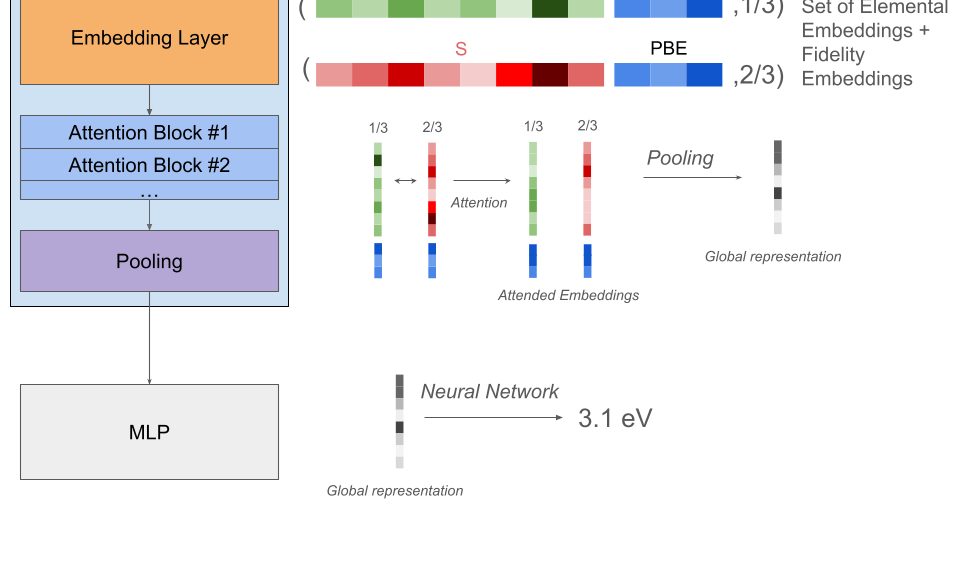
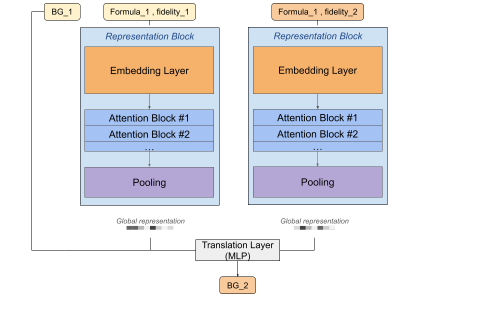
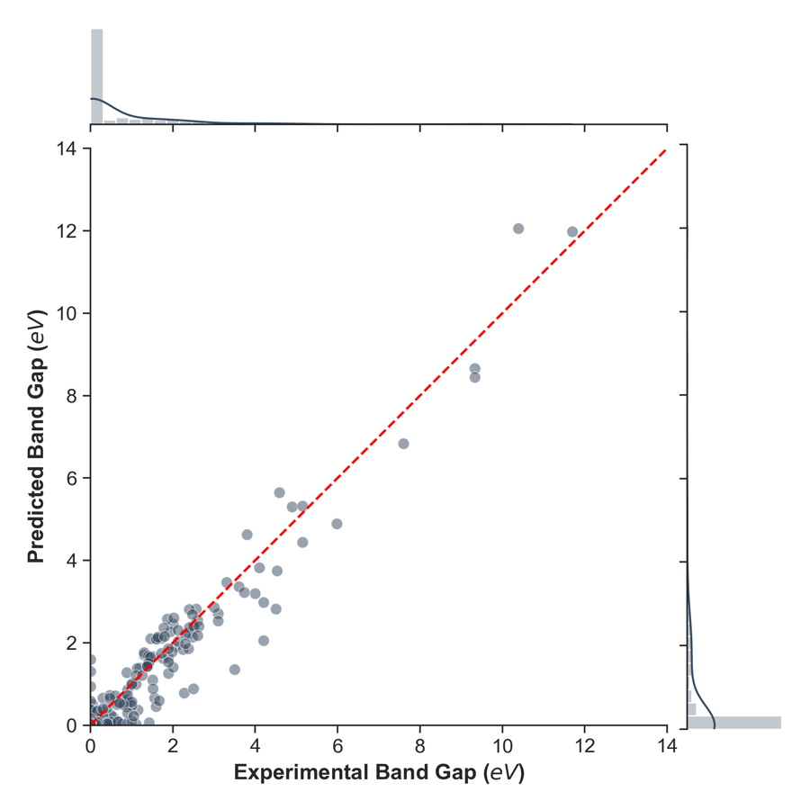

# FETT

**[github.com/nkrygernelson/FETT](https://github.com/nkrygernelson/FETT)** · Python, PyTorch Lightning, Hydra

FETT (Fidelity-Embedding Transformer Translator) is the machine learning model I
built for the paper
**[AI-enhanced discovery and accelerated synthesis of metal phosphosulfides](https://arxiv.org/abs/2601.16693)**,
with Javier Sanz Rodrigo, Lena A. Mittmann, Eugène Bertin, Ivano E. Castelli and
Andrea Crovetto at DTU. I designed and implemented the ML pipeline (architecture,
training and evaluation). The DFT calculations and the thin-film synthesis are the
work of my co-authors.

## The problem

The band gap decides whether a material is useful for things like solar cells.
Cheap DFT calculations (here PBEsol) can be run on thousands of hypothetical
materials, but they systematically underestimate the band gap. Accurate methods
and experiments are too expensive to run at that scale.

FETT takes a chemical formula and its cheap PBEsol band gap and predicts what the
experimental band gap would be. It needs no crystal structure, so it works on
materials that have never been made.

## How it works

There are two stages.

**1. Base model.** It reads a formula and a *fidelity* label (PBE, PBE+U,
PBEsol, SCAN, GLLB-SC, HSE or experimental). Each element gets a learned
embedding with the fidelity embedding attached. A permutation-invariant
transformer lets the elements attend to each other, and a pooling step squashes
them into one *global representation* of the compound at that fidelity. An MLP
reads off the band gap. It is trained on about 350,000 entries from public
databases.

**2. Translation layer.** The base model is frozen and its MLP is thrown away.
The compound is embedded twice, once at the source fidelity and once at the
target fidelity. A small MLP takes both representations plus the known source
band gap and predicts the target band gap.

The split exists because of a data imbalance: cheap DFT data is plentiful, but
pairs of (DFT, experiment) for the same compound are scarce. The base model
learns chemistry from the plentiful data, and the translation layer only has to
learn the correction.

## Result

On held-out data (5-fold cross-validation), PBEsol to experiment translation
reaches a mean absolute error of **0.168 eV**, less than half of the **0.371 eV**
the base model gets predicting experimental gaps from composition alone.

In the paper, the model translated in-house PBEsol band gaps for 909 hypothetical
ternary phosphosulfides into experimental estimates, which helped choose
candidates for synthesis.

---

[⬅ Back to Projects](./projects.html) · [Home](./index.html)
