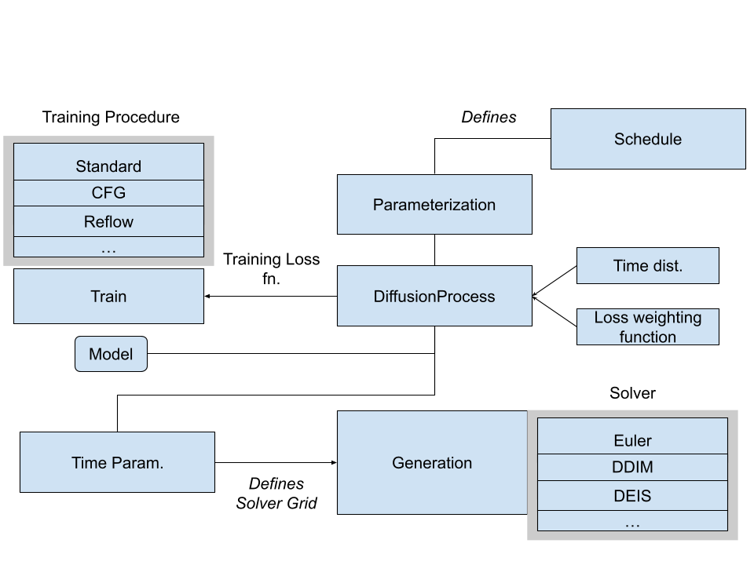

# POD

**[github.com/nkrygernelson/POD](https://github.com/nkrygernelson/POD)** · Python, PyTorch, Hydra

POD is a research codebase for training and sampling diffusion models. Every
design choice in a diffusion model (noise schedule, prediction target, time
coordinate, sampler, training procedure, dataset) is its own swappable
component. Comparing two choices is a command-line override, not a rewrite:

```bash
python main.py parameterization=score_pred solver=ddim time_param=logsnr
```

<!-- TODO: one or two sentences on why you built it / what question it helps you ask. -->

## The big picture

Everything is wired together around `DiffusionProcess`. It takes a
parameterization (which needs a schedule), a time distribution, a loss weighting
and a model, and turns them into a training loss. `train.py` minimizes that loss
with one of the training procedures. `generation.py` then samples with one of the
solvers, on a time grid set by the time parameterization.



<!-- TODO: optional sentence walking through the diagram in your own words. -->

`main.py` just runs the two scripts in order and passes the same overrides to
both.

## Repo map

| Folder | What lives there |
|---|---|
| `configs/` | One sub-folder per swappable component. Start with `base.yaml`. |
| `diffusion/` | The diffusion machinery: `DiffusionProcess`, schedules, parameterizations, time coordinates, solvers. |
| `models/` | Networks (MLP, U-Net) and the classifier-free guidance wrapper. |
| `data/` | Datasets: 2D toy targets (tree, blobs) and MNIST. |
| `train.py`, `generation.py` | The two entry points. |

## Three ideas worth knowing

### 1. One class for every prediction target

A network can predict the noise, the clean sample, the score or the velocity.
Every one of these is a linear combination of $$x_0$$ and $$\epsilon$$, so each
parameterization only defines two coefficients $$(a, b)$$. One shared $$2\times2$$
inversion recovers $$(x_0, \epsilon)$$, and everything else follows from there.

```python
class Parameterization:
    def coeffs(self, t):            # each subclass only defines this
        raise NotImplementedError

    def to_x0_eps(self, model_out, x_t, t):   # the one inversion
        a, b = self.coeffs(t)
        alpha, sigma = schedule.alpha(t), schedule.sigma(t)
        det = alpha * b - sigma * a
        x_0 = (b * x_t - sigma * model_out) / det
        eps = (-a * x_t + alpha * model_out) / det
        return x_0, eps

class NoisePred(Parameterization):
    def coeffs(self, t):
        return 0.0, 1.0
```

The practical payoff: any sampler works with any trained network.

<!-- TODO: optional sentence on the det → 0 caveat and the singularity report. -->

### 2. Two clocks

The schedule is evaluated at time $$t$$. The network sees a reparameterized time
$$u = f(t)$$, e.g. log-SNR. This puts more training and sampling steps where the
signal-to-noise ratio actually changes.

<!-- TODO: your own explanation of why this matters. -->

### 3. Training procedures share one loop

The loss is always a weighted regression onto the parameterization's target.
The training procedures only change what goes into it:

- **standard**: fresh Gaussian noise.
- **cfg**: labels are randomly dropped, so one network learns both the
  conditional and unconditional model.
- **reflow**: noise is replaced by the partner $$x_1$$ that a teacher model maps
  $$x_0$$ to. This straightens trajectories and allows few-step sampling.

<!-- TODO: anything you want to add about reflow results. -->

## Status and next steps

The repo trains, samples, and writes diagnostic figures to a per-run output
folder.

<!-- TODO: open threads, e.g. pair selection for velocity training, higher-dimensional data. -->

---

[⬅ Back to Projects](./projects.html) · [Home](./index.html)
